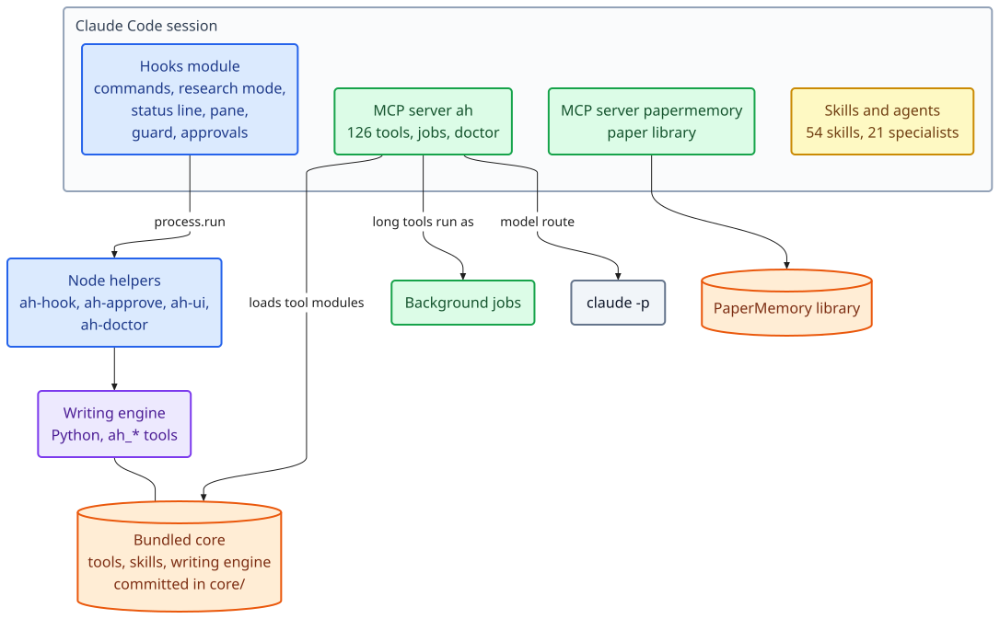

# cc-mod-academic-harness

A Claude Code plugin for academic research and writing. It adds literature search across the scholarly APIs, web search and page reading through whichever provider you have a key for (with fallbacks, so a missing key is never a dead end), citation and integrity checks, deep research and deep review that run as background jobs, a PaperMemory library, 59 research skills and 21 specialist agents, hypothesis tournaments, study-design and reproducibility ledgers, a guard for writing papers in LaTeX projects (`ah.yaml`), and a local loop that learns lessons from your corrections.

It is a Claude Code *mod*: next to its MCP tools, skills and agents it runs code inside Claude Code, which is what gives it slash commands, a status line, a pane and the guard ([what that means](docs/maintain/next-steps.md#plugin-or-mod-both-and-it-works)).

**Version 0.6.1.** Linux only. MIT licence.

## How it fits together



Blue is code that runs inside Claude Code's hooks, green the MCP servers and background jobs, purple the writing engine, orange stored data (the bundled core, the PaperMemory library and the lessons the self-improvement loop has learned), yellow skills and agents, and grey what is outside the plugin: the model route, the search and fetch APIs, the project's `.mcp.json` and the `zg` index. The diagram is `docs/assets/architecture.mmd`, rendered with [Pele](https://github.com/obsidianmd/pele) (`node core/skills/pele/scripts/render.mjs --static-colors docs/assets/architecture.mmd docs/assets/architecture.svg`). [Architecture](docs/design/architecture.md) explains each part.

## Requirements

| | |
|---|---|
| **OS** | Linux. The writing engine is Linux-only |
| **Node.js** | 22 or newer, with `npm` and `tar` |
| **Claude Code** | 2.1.325 or newer, the oldest version the mod was seen working on; `/academic doctor` reports the running version and whether the hooks module loaded |
| **Python** | 3.11 or newer for the writing engine. `uv` is used when present, otherwise `python -m venv` and pip |
| **Login** | a working `claude` login for the tools that call a model. They need no API key |

## Quick start

```
git clone https://github.com/raktim-mondol/cc-mod-academic-harness
cd cc-mod-academic-harness
node scripts/setup.mjs
claude --plugin-dir "$PWD"
```

or, installed from the marketplace (the first session sets itself up):

```
/plugin install academic-harness --marketplace raktim-mondol/cc-mod-academic-harness
```

Then, in a session: `/academic doctor` says what is ready. [Getting started](docs/guide/getting-started.md) has the details.

## In a session

In a folder with an `ah.yaml`, the status line keeps one line:

```
research mode on · 1 job running · gate FAIL (5 blocking)
```

`/academic` opens a pane with the paper state, this session's jobs, the notebook and the PaperMemory counts. `/ah-research`, `/ah-review` and the other task commands start long runs as background jobs and tell you when they end; `/academic usage` shows which tools and skills are actually used.

## What you get

| | |
|---|---|
| **Research mode** | A research section in the system prompt, on automatically in a folder with an `ah.yaml` (`/academic on\|off\|auto`) |
| **Tools** | 129 tools in 16 areas (up to 139 when search-provider keys are set): search, papers, notebook, the writing engine, reviews, tournaments, analysis, provenance, study design, datasets, submission, deep research and review, paid compute |
| **Web search and page reading** | Eight providers (Brave, Tavily, Exa, Perplexity, Parallel, Consensus, Elicit, Firecrawl) each serve themselves once their key is set, with one job each. `web_search` picks the best one that is on, falls back when one fails, and can cross-check a claim with two independent indexes; `web_extract` reads pages with Firecrawl, then Parallel, then Jina. With no key at all, Claude uses `WebSearch`, `WebFetch` and any connector you have ([keys](docs/guide/keys.md)) |
| **Self-improvement loop** | Off unless you turn it on (the `rsi_mode` setting or `AH_RSI`). When on, in a folder with an `ah.yaml` and with a person at the prompt (never in a headless run), it learns short lessons from your corrections and tool results: `observe` only records, `auto` also adds the lessons that fit to your prompts. `ah_rsi` shows and forgets them and the doctor shows the mode |
| **Paper2MCP** | `paper_mcp` registers a generated server in the project's `.mcp.json` after you confirm; Claude Code asks again before it starts it |
| **Skills and agents** | 59 core skills, about 700 more on demand, 21 specialists such as `academic-harness:peer-reviewer` |
| **Commands** | `/ah-research`, `/ah-review`, `/ah-papers`, `/ah-references`, `/ah-write`, `/ah-analyze`, `/ah-hypotheses`, `/ah-watch`, `/fold`, `/academic`, `/model-router` |
| **Model router** | Off until you turn it on (`/model-router on`): planning goes to Opus, coding to Sonnet, academic writing to Haiku, everything else to Sonnet, decided by Jev (TypeSafe) or keyword rules ([the model router](docs/guide/model-router.md)) |
| **Interface** | A status line (`research mode on · 1 job running · gate FAIL (5 blocking)`) and a pane (project state, jobs, notebook, library) |
| **Guard** | In a folder with an `ah.yaml`: protected files, unit anchors and author-only acts enforced on every write and shell call |
| **Safety** | Paid compute and `paper_mcp` registration always ask (and are refused where nobody can answer). Keys are never printed. Tools stay inside the project folder. Text from the web and from papers is fenced as untrusted |

## Optional: search provider keys

Nothing needs a key to start. To add a provider, save its key (`brave_api_key`, `tavily_api_key`, `exa_api_key`, `perplexity_api_key`, `parallel_api_key`, `consensus_api_key`, `elicit_api_key`, `firecrawl_api_key`) with `claude plugin configure academic-harness@academic-harness-mod` and restart Claude Code. `/academic doctor` lists which providers are on. [Keys and credentials](docs/guide/keys.md) has the details and [tools, skills and agents](docs/guide/tools-skills-agents.md#search-providers-and-the-web-tools) says how the choice is made.

## Optional: semantic workspace search

The plugin does not bundle zvec-grep. Its `zvec_index` tool builds the index with the `zg` you install (and asks before it indexes), but the search itself is zvec-grep's. If you want meaning-based search over the workspace, with exact and regex search through the same interface, install it and run its own Claude Code integration:

```
npm install -g @zvec/zvec-grep --allow-scripts=@zvec/zvec-grep
zg install --target claude --yes --mcp-toolset full
```

That adds the `mcp__zvec_grep__*` tools to Claude Code: `zvec_grep_search` for semantic or cross-file discovery, `zvec_grep_rg` for exact and regex search, and the index and status tools. It also pre-approves them and writes retrieval guidance to `~/.claude/CLAUDE.md`. Indexing is per workspace and opt-in: `zvec_grep_index` creates `<project>/.zvec-grep/`, the default embedding runs locally, and the shared daemon listens on loopback only. Research mode uses these tools when they are present and falls back to `Grep` and `Glob` otherwise; [what was left out and why](docs/design/fit-review.md) explains why the plugin does not serve the search itself.

## Documentation

Every folder has its own index; start from [the documentation index](docs/README.md).

| For | Start at |
|---|---|
| **Using it** | [User guide](docs/guide/README.md): [getting started](docs/guide/getting-started.md), [commands](docs/guide/commands.md), [tools, skills and agents](docs/guide/tools-skills-agents.md), [settings](docs/guide/settings.md), [keys and credentials](docs/guide/keys.md), [state and privacy](docs/guide/state-and-privacy.md), [troubleshooting](docs/guide/troubleshooting.md) |
| **Understanding it** | [Design](docs/design/README.md): [architecture](docs/design/architecture.md), [decisions](docs/design/decisions.md), [what was left out and why](docs/design/fit-review.md) |
| **Changing it** | [Maintenance](docs/maintain/README.md): [building](docs/maintain/building.md), [testing](docs/maintain/testing.md), [releasing](docs/maintain/releasing.md), [what to do next](docs/maintain/next-steps.md) |
| **How it was built** | [History](docs/history/README.md), and the [changelog](CHANGELOG.md) |

## Development

`npm run check` runs the same checks CI runs: the node suites, `plugin.json` against the core, and the served tool surface. `npm run typecheck` adds the hooks module's types after a session has loaded the mod, and `npm run build` regenerates the skills, prompt, agents and interface from `core/`.

The ground rules, the test map and the release checklist are in [Maintaining the mod](docs/maintain/README.md); [CONTRIBUTING.md](CONTRIBUTING.md) is the short version.

## The repository

| Folder | What is in it | Notes |
|---|---|---|
| [`hooks/`](hooks/README.md) | The code that runs inside Claude Code: research mode, the guard, approvals, commands, the pane | TypeScript |
| [`server/`](server/README.md) | The tool server, the PaperMemory launcher and the helper processes the hooks run | Node |
| [`scripts/`](scripts/README.md) | Setup, builds, checks | Node |
| `skills/`, `agents/` | The skills and agents Claude Code loads | Generated; do not edit ([Building](docs/maintain/building.md)) |
| [`tests/`](tests/README.md) | Plugin tests, node suites, live scripts | |
| [`types/`](types/README.md) | The `$.state` contract of the hooks module | |
| `core/` | The research engine, tool code, writing engine and about 790 skills the plugin runs, with the licences they carry ([`core/NOTICE`](core/NOTICE)) | Committed, so the repository stands alone; `setup` installs what is built from it |
| `.claude-plugin/` | The manifest and the marketplace file | `plugin.json` is partly generated |

## Security

Keys reach the tools as environment variables and are reported by name, never by value. In an `ah.yaml` project the guard fails closed, and paid compute always asks. What is read, written and spent is in [state and privacy](docs/guide/state-and-privacy.md). Report a vulnerability privately through [SECURITY.md](SECURITY.md), never in an issue.

## Licence

MIT (`LICENSE`) for the code written for this mod and for Academic Harness's own code in `core/`. **`core/` also bundles other projects' material under their own licences, and the MIT licence does not relicense it:** 791 skills, of which 6 are CC BY-NC-SA 4.0 (non-commercial), 5 name a GPL licence and 12 say "Unknown", plus vendored projects such as Supervisor-Skills (CC BY-NC-SA 4.0 as a whole). `NOTICE` lists them and says what each needs; a skill's `license:` line names its licence. If you use this repository commercially, read `NOTICE` first, and set `AH_EXCLUDE_NONCOMMERCIAL=1` to keep the six non-commercial skills out of what the plugin serves. The 54 core skills in `skills/` are the ones the build lets in: only MIT, CC BY 4.0 and the source's own text; each outside MIT is credited, with its changes, in `NOTICE`. Contributions are under the same licence; see [CONTRIBUTING.md](CONTRIBUTING.md).
