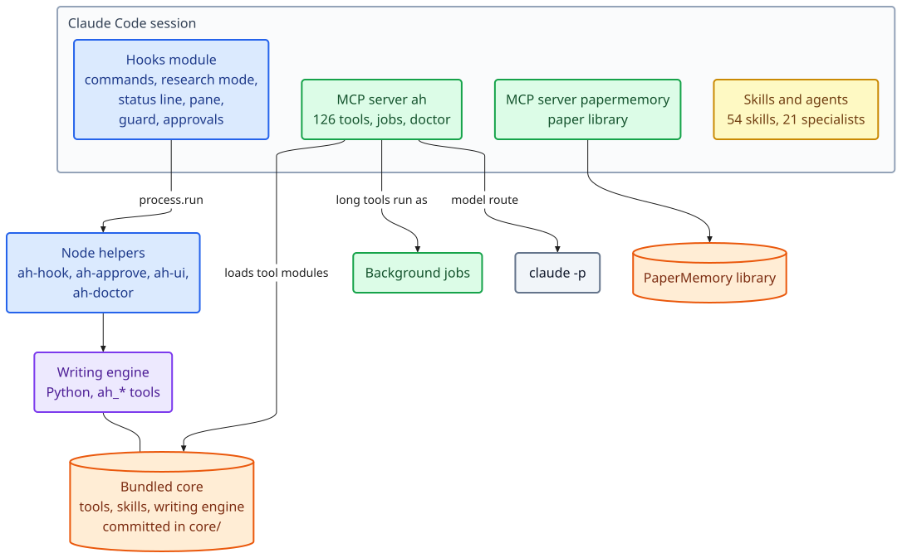

# Architecture

The plugin gives Claude Code the Academic Harness research toolkit: its tools, skills, a writing engine and a library of papers. A Claude Code mod's hooks module has no Node and no DOM and reaches the outside only through the engine interface `$`, so the plugin has two halves that talk through processes and MCP.

Blue is code that runs inside Claude Code's hooks, green the MCP servers and background jobs, purple the writing engine, orange stored data (the bundled core, the PaperMemory library and the self-improvement loop's lessons), yellow skills and agents, and grey what is outside the plugin: the model route, the search and fetch APIs, the project's `.mcp.json` and the `zg` index. The source is `docs/assets/architecture.mmd`, rendered with Pele.

| Part | Where | What it does |
|---|---|---|
| Hooks module | `hooks/register.tsx` | Runs inside Claude Code, with no Node. Research mode and the system-prompt section; the slash commands `/academic`, `/ah-*`, `/fold`, `/ah-watch`; the status line, pane and completion notices; the writing-engine guard and approvals (`tool.check`); the feed for the self-improvement loop. It reaches the outside with `$.process.run`, which starts `node server/bin/ah-{hook,approve,ui,doctor}.mjs` |
| MCP server `ah` | `server/bin/ah-mcp.mjs` | One Node process over stdio. Loads the research tool modules from the engine code through a small context shim: 124 tools plus the four `job_*` tools and `doctor` (129), deferred behind ToolSearch, and up to 10 more when a search provider's key is set (`web_search`, `web_extract` and the provider tools, 139 in all); the jobs service and the model route (headless `claude -p`); fetches the engine code itself on first start (`bootstrap.mjs`) |
| MCP server `papermemory` | `server/bin/papermemory-mcp.mjs` | A launcher for `papermemory mcp` |
| Skills | `skills/` | 59 core skills and the guides, among them `search-providers` (generated; `scripts/guides/` holds the guides written for this plugin) |
| Agents | `agents/` | 21 specialists (generated) |

## The engine code

The tool modules, the prompt the skills and guides come from, the skills, the vendored writing engine (Python), PaperMemory and the deep-review engine are in `core/`, committed in this repository (about 3,300 files, 44 MB). It began as a copy of Academic Harness at one commit (0.54.1) and is this repository's own source now: nothing follows that project, and nothing is fetched. What is built from it (`node_modules`, the engine's Python environment) is not committed; `scripts/setup.mjs` installs it in place, and an installed copy of the plugin gets a working copy of `core/` in the mod's home on first start (`server/src/bootstrap.mjs`), so an update of the plugin replaces the code and leaves the installed dependencies alone when the core did not change. See [Building](../maintain/building.md).

## The tool server (`server/`)

The research tool modules register tools against a `ctx` object. The server gives them one:

| File | Role |
|---|---|
| `manifest.mjs` | Which modules to load, by area; which are not loaded; which are left out (`fit.mjs`) |
| `context.mjs` | The `ctx` shim: `tools` (a registry), `get` for optional services, subscriptions. A service the plugin does not provide throws a named error |
| `host.mjs` | `createHost` loads the modules and runs a call; `serve` is the stdio MCP loop (initialize, tools/list, tools/call, cancellation, `roots/list` so `/cd` is followed) |
| `exec.mjs`, `schema.mjs` | The per-call `exec` (call id, abort signal, session id, working folder) and parameters to JSON schema |
| `render.mjs` | Output blocks to MCP content; a result over 40,000 characters is cut with the whole text in `<project>/.dsh/tool-output/`; wording rules for text that names something this plugin does not have |
| `jobs.mjs`, `jobtools.mjs` | Long tools (`deep_research`, `deep_review`, `analysis_run`) detach after a foreground window and run as jobs kept on disk; `job_status/wait/log/kill` |
| `llm.mjs` | The model route: `ctx.llm` answered by a headless `claude -p --safe-mode --tools ""`, no key, capped |
| `engine*.mjs` | Where the writing engine's environment is, whether it is ready, how it is built |
| `bootstrap*.mjs`, `late-host.mjs`, `snapshot.mjs` | The first start with nothing installed: answer at once, copy the core and install its dependencies, swap the tool list |
| `doctor.mjs`, `doctortool.mjs` | What is ready, as a report and as a tool |
| `usage.mjs` | Usage counts: a recorder per writer, the files added up, the report. Names and numbers only |
| `webtools.mjs` | `web_search` and `web_extract`: the provider picked from the ones that are on (a key is set), the fallback when one fails, the cross-check of a claim by two independent indexes, Firecrawl then Parallel then Jina for reading a page. Present only when a provider is on; the listing is fenced as untrusted text |
| `mcpjson.mjs` | How `paper_mcp` registers a Paper2MCP server with Claude Code: the entry goes into the project's `.mcp.json` (variable names, never values), and the tool's description and results say so |
| `rsi-bridge.mjs` | The self-improvement loop, one hook event at a time: the open turn is kept in a file per session under a lock, the stop gate decides when a turn ends, lessons come back as extra context |
| `compat.mjs` | The Claude Code versions the mod was seen working on; reads the record the hooks module leaves at session start, so the doctor can say whether that module loaded and on which version |
| `panel.mjs` | Project state and library counts for the pane |
| `env.mjs`, `paths.mjs`, `fit.mjs` | The environment the modules see, where things are, what is left out and which search providers serve themselves once their key is set |

The modules are loaded in-process from the engine code, unchanged. The plugin does not run the engine code's own start-up routine, which would seed skills and patch profiles outside this plugin.

## The hooks module (`hooks/`)

| File | Role |
|---|---|
| `register.tsx` | The one `session.start` hook (Claude Code refuses two with no matcher) and every other registration |
| `mode.ts` | Research mode, and `showStatus`, the only writer of the one status line |
| `guard.ts`, `guard-core.ts` | The four classic events run the writing engine's `ah hook` through `ah-hook.mjs` in an `ah.yaml` project; fail closed for writes and shell |
| `approvals.ts` | `tool.check`: `ah_author` and `ah_migrate apply` ask, `paper_mcp` register and approve ask (they write an entry that runs a program), paid compute always asks |
| `rsi.ts`, `rsi-core.ts` | A `classic.PostToolUse` hook for every tool in an `ah.yaml` project that hands the loop what the tool returned (cut to a bounded size); advisory, it never blocks |
| `notices.ts`, `jobs-core.ts` | Job completion notices |
| `tasks.ts`, `tasks-core.ts` | The task commands, `/ah-watch`, `/fold` |
| `ui.tsx`, `ui-core.ts` | The pane and the status line's parts |
| `doctor.ts` | `/academic doctor` |
| `seen.ts` | The record that the module loaded, for the doctor |
| `usage.ts` | Counts the plugin's skills and agents as Claude starts them (a `classic.PreToolUse` hook that changes nothing) and the commands run |
| `generated/` | The research-mode text, the task catalogue and the fold |

The `-core.ts` files are pure (no `$`, no Node), so node tests import them as they are.

## How the pieces meet

- **A tool call.** The model finds a tool with `ToolSearch` and calls `mcp__plugin_academic-harness_ah__<tool>`; the server checks the arguments against the tool's schema (`server/src/validate.mjs`), runs the module with a fresh `exec` and renders the result.
- **A guarded write.** In a folder with an `ah.yaml`, `classic.PreToolUse` runs `ah-hook.mjs pre`, which runs the writing engine's `ah hook pre` and returns its verdict (about 0.14 s). No answer means no write.
- **A task command.** The command hook checks the line, then `$.tool.call`s the tool. A tool call from a hook needs no permission rule: only a deny rule, a hook's `ask` or an organization's ask refuse it.
- **A long job.** The tool answers after about 30 seconds with a job id; the record on disk is read by a timer in the hooks module, which notifies and, by default, prompts the model to read the result.
- **The pane and the status line.** A timer reads the job records and, through `ah-ui.mjs`, the writing engine's state card and the PaperMemory counts; the pane draws what was last stored.
- **A web search.** `web_search` looks at which providers are served, takes the best for the kind of search (`general`, `semantic`, `fresh`, `news`, `excerpts`), falls to the next when one has no key, fails or finds nothing (three tries at most), and says which answered. `intent=claim` asks one provider from each of two independent groups and marks what both returned. With no key at all the tool does not exist, and research mode sends Claude to `WebSearch` and `WebFetch` and to any search connector you have signed in to.
- **A page read.** `web_extract` tries Firecrawl, then Parallel Extract, then Jina Reader (keyless) for each URL and names the reader; a URL none could read is listed. The text is fenced as untrusted.
- **A self-improvement turn.** In an `ah.yaml` project the guard's `UserPromptSubmit` call also runs the loop: it closes the turn before, opens this one, records a stated preference, and returns the lessons for this kind of task as extra context. Each tool's result arrives through `rsi.ts`; the `Stop` call asks what the stop gate did, and while the gate blocks the stop the turn goes on. The store is `<home>/ah-rsi/`; the `rsi_mode` setting (the hooks module hands it to the bridge as `AH_RSI_SETTING`; the `AH_RSI` variable wins) set to `observe` records without adding anything to prompts, and `off` stops it.
- **A Paper2MCP server.** `paper_mcp register` first asks the person (a `tool.check` ask that shows the program that will run; where nobody can answer it is a refusal), then writes the entry into the project's `.mcp.json`. Claude Code asks again, with its own dialog, before it starts a project server and the person reloads with `/mcp`.
- **The first start.** See [Getting started](../guide/getting-started.md).

## What the plugin adds, and what it leaves out

It adds what only Claude Code has: commands, a pane and a status line, the guard on Claude's own tools, approvals through Claude Code's dialogs, and a model route under your login. It leaves out what Claude Code already does ([what is left out and why](fit-review.md)), and rewrites the passages of its skills and guides that give advice wrong for Claude Code ([`scripts/adapt.mjs`](../maintain/building.md)).

## Licences

Code written for the plugin is MIT (`LICENSE`), and so is Academic Harness's own code in `core/` (Copyright 2026 Academic Harness, formerly ResearchCraft, the same author). **`core/` is not all MIT.** It carries the third-party material that Academic Harness bundles, each under its own licence, and `NOTICE` and `core/NOTICE` list it. Decision, 2026-11-17: the repository stands alone and commits all of `core/`, including the skills and vendored projects whose licences are non-commercial or GPL, with that said in the README and `NOTICE` and not by leaving them out. The consequence to know: someone who uses this repository commercially has to read `NOTICE` and leave out what its licence does not allow.

What the build lets into `skills/` (the 59 core skills, plus the guides, that Claude Code lists) is narrower, and unchanged from the review settled on 2026-11-16:

- Skills under non-commercial, GPL or unknown licences are left out of `skills/` by the build (decision D5), and `skills/.build-info.json` records each with its licence. The 59 that are copied name MIT, CC-BY-4.0 or nothing (the source's own text).
- Eight skills come from K-Dense (MIT): their copyright lines are in `NOTICE`.
- Three come from Supervisor-Skills with `license: CC-BY-4.0` in their own frontmatter and are credited in `NOTICE` with their changes. That repository as a whole is CC BY-NC-SA 4.0, and `core/vendor/supervisor-skills` holds it.
- `remove-ai-signs/references/signs.md` is adapted from a Wikipedia essay (CC BY-SA 4.0), and `NOTICE` says it is not under the MIT licence.
- A skill the model loads on demand from `core/skills` can be under a non-commercial licence; each skill's `license:` line says.

`tests/scripts/repo.test.mjs` fails when a skill is copied whose licence is not one the build allows, or when a licence other than MIT has no entry in `NOTICE`.

