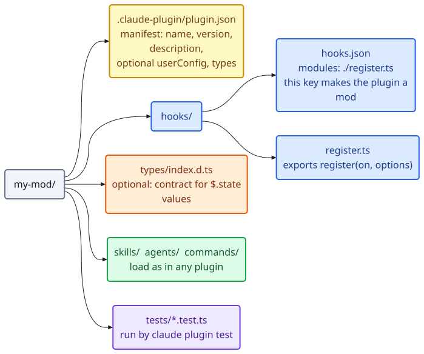

# How Claude Code mods work

A working guide to the mod system, written for `cc-mod-academic-harness`. It condenses the Claude Code mods documentation (v2.1.287 and later) and adds what it means for this project. Statements marked **[checked]** were confirmed against the type declarations of the local build (2.1.325); the rest come from the documentation text.

## 1. What a mod is

A mod is a Claude Code **plugin** whose code runs **inside** Claude Code. The code is a set of event handlers called *hooks*. When an event happens (a tool call, a submitted prompt, part of the interface being drawn), Claude Code calls the matching hook, and the hook can watch the event, change it, or answer it itself.

How it differs from the neighbours:

| | Mod | Settings hook | Skill | MCP server |
|---|---|---|---|---|
| What it is | Functions Claude Code calls in its own process | A shell command or HTTP call run on an event | Instructions in a `SKILL.md` | A separate process that gives Claude tools |
| Can change tool calls, prompts, turns | Yes | Partly (allow, block, add context) | No | No |
| Can draw interface (panes, bands, rows) | Yes | No | No | No |
| Written in | JS or TypeScript, no build step | Any language | Markdown | Any language |

One plugin can hold all four. That is how this plugin is laid out: a mod for behaviour and interface, an MCP server for the tools, skills for knowledge.

## 2. Anatomy



The source is `docs/assets/mod-layout.mmd`.

- `modules` takes exactly one path, relative to `hooks.json`. Files may be `.js .mjs .cjs .jsx .ts .mts .cts .tsx` and are always ES modules.
- `register(on, options)` runs when the mod loads. `options` holds the values of the manifest's `userConfig` fields.
- The hooks module has **no Node, no DOM, no `setTimeout`, no file or network access of its own.** Everything outside goes through `$`. Standard web APIs (`URL`, `TextEncoder`, `AbortController`, `crypto.subtle`) are available.

## 3. The hook model

```ts
export const register: Register = (on, options) => {
  on('tool.call', { tool: 'Bash' }, async ($, e, next) => next(e))
}
```

Every hook receives:

| Argument | Meaning |
|---|---|
| `$` | The mods API: `$.ui`, `$.fs`, `$.process`, `$.command`, and so on |
| `e` | The event's input, deeply frozen. Assigning to it throws |
| `next` | Runs the mods beneath this one and then Claude Code's own behaviour; resolves to the event's result |

Hooks on one event form a middleware chain, the first mod outermost. A hook has three ways to handle an event:

1. **Observe.** Do work, then `return next(e)`. The event goes on unchanged.
2. **Rewrite.** `next({ ...e, text: e.text.trim() })`. The rest of the chain sees the copy.
3. **Answer.** Return a result without calling `next`. Claude Code's own behaviour never runs (`{ deny }`, `{ result }`, `{ text }`).

Before or after: code before `next` runs ahead of the event, code after `await next(e)` runs once the event has a result.

### Matchers

The optional second argument filters events. Each field may be a value, an array, or a regular expression:

```ts
on('tool.call', { tool: 'Bash' }, hook)
on('tool.call', { tool: ['Edit', 'Write'] }, hook)
on('tool.call', { tool: /^mcp__ah__/ }, hook)
```

`'classic.*'` matches every settings-hook event. Add `plugin` to a matcher to hook another mod's panes and controls.

### Order

Outermost first: the built-in guard and the organisation's `prependPlugins`, then mods you install, then `appendPlugins`, then other built-ins. A mod runs before the mods it lists under `dependencies`. Inside one module, hooks run in the order `register` called `on`.

### Failure

A hook that throws, times out or returns the wrong shape is **skipped**, and the tool runs anyway. For a hook that guards something, chain a `.catch` so it fails closed:

```ts
on('tool.call', { tool: 'Bash' }, guard).catch(async ($, e, next) => {
  if (next.called) return next(e)
  return { deny: 'The guard failed, so this command was not run.' }
})
```

The `.catch` handler has a 1-second limit of its own.

## 4. The static-analysis rules

Claude Code reads the hooks module's source before running it. `claude plugin validate` uses the same reader. A module that breaks these rules fails to load:

- Write every API call in full: `$.store.get('k')`. No `const ui = $.ui`, no destructuring `$`, no computed names. Passing `$` to a top-level function in the same file is allowed.
- Event names in `on(...)` are string literals. No variables, no loops over names.
- Inside `register`, do not declare another variable or parameter called `on`.
- Imports: top-level `import` of files inside the plugin by relative path, plus the bare `claude-code` (types and helpers). No dynamic `import()`, no `require`.
- Register each event once per matcher. Two `session.start` hooks with no matcher fail the load.

## 5. Events

| Group | Events |
|---|---|
| Tools | `tool.call`, `tool.check`, `tool.describe`, `tool.list` **[checked]** |
| Prompts | `prompt.submit`, `prompt.compose`, `prompt.section`, `prompt.context`, `prompt.fill`, `prompt.suggest`, `prompt.edit`, `prompt.autocomplete`, `prompt.attachment`, `prompt.mention`, `skill.prompt` |
| Commands, config | `command.run`, `command.describe`, `config.set`, `config.describe`, `settings.read` |
| Turns | `turn.start`, `turn.step` (async generator), `turn.complete` |
| Session | `session.start`, `session.end`, `session.compact`, `session.receive`, `session.send`, `session.append`, `session.attach`, `session.detach`, `session.measure` |
| Agents | `agent.offer`, `agent.spawn` |
| Interface | `ui.render`, `ui.resolve`, `ui.press`, `ui.input`, `ui.select`, `ui.focus`, `ui.scroll`, `ui.close`, `ui.message`, `ui.fault` |
| Plugin, telemetry | `plugin.register`, `engine.create`, `telemetry.log`, `telemetry.mark` |
| Settings hooks | `classic.<Event>`, for example `classic.Stop`, `classic.PreToolUse`; `e` is the hook's stdin JSON |

Every `$` call is itself an event (`fs.read`, `process.run`, `model.complete`, ...). An earlier mod in the chain, such as an organisation policy mod, can observe, rewrite or refuse it.

## 6. What the common events let you do

**`tool.call`** fires before a tool runs. Refuse (`{ deny }`), rewrite the arguments (`next({ ...e, ... })`), answer without running (`{ result }`), retry (`next(e)` again), or withhold the result after the fact (`await next(e)` then `{ deny }`). A hook may `await` before calling `next`; the call stays pending, so it can ask the user with `$.ui.ask(question, options)`. That dialog rejects when dismissed or when nobody is there to ask (`claude -p`), so wrap it in `try`/`catch` and treat rejection as a refusal.

**`tool.check`** fires when Claude Code decides whether a call may run, after settings `PreToolUse` hooks and before the permission prompt. Return `{ decision: 'allow' }`, `{ decision: 'ask', reason }` or `{ decision: 'deny', reason }`, or pass through `await next(e)` for the engine's verdict. `e.isReadOnly` marks calls the tool itself reports as read-only; do not approve on that alone.

**`prompt.submit`** sees each prompt before the turn. Rewrite it (`next({ ...e, text })`), add text only Claude reads (`context`), or stop it (`{ drop: reason }`).

**`prompt.compose`** sees the system prompt as `{ sections }`. Answer `next(e)`'s result with one more section added (scope `session`), or replace or drop sections.

**`turn.step`** is an async generator: `yield* next(e)` forwards the streaming response, and `next({ ...e, model })` sends the request to another model. **`turn.complete`** can return `{ text }` to show a line under the answer. It cannot block the turn.

**`command.run`** answers a slash command registered with `$.command.register` in `session.start`. Return `{ text }`. `immediate: true` lets it run while Claude is working. Registering a name a built-in command already has throws.

**`ui.render`** draws interface; see section 8.

## 7. The mods API (`$`)

| Namespace | What it is for |
|---|---|
| `$.plugin` | `name`, `root` (this plugin's folder) |
| `$.ui` | `open`, `close`, `invalidate`, `status`, `toast`, `log`, `notify`, `ask`, `place`, `focus`, `scroll`, `copy`, `selection`, `view` |
| `$.command` | `register`, `run`, `list` |
| `$.tool` | `register`, `call`, `check`, `list` |
| `$.agent` | `register`, `spawn`, `list` |
| `$.model` | `complete`, `fork`, `classify` |
| `$.prompt` | `submit`, `read`, `fill`, `suggest`, `compose` |
| `$.session` | `messages`, `cwd`, `root`, `id`, `model`, `usage`, `send`, `compact`, ... |
| `$.fs` | `read`, `write`, `list`, `exists`, `stat` (4 MiB per file; `write` is not atomic) |
| `$.process` | `run` (argv list, no shell), `spawn` (streams) |
| `$.http` | `fetch` (4 MiB, 30 s, 5 redirects) |
| `$.mcp` | `call` (a connected server's tool), `connect` (a server named in the manifest) |
| `$.clock` | `now`, `sleep`, `after`, `every` (the replacement for `setTimeout` and `setInterval`) |
| `$.state` | Reactive session state that survives reloads; helpers `atom`, `read`, `update` from `claude-code` |
| `$.store` | JSON key-value store shared across sessions (4 MiB total) |
| `$.env` | `get`, `set` (names as string literals) |
| `$.config`, `$.settings`, `$.theme`, `$.audio`, `$.telemetry`, `$.turn` | Configuration, settings reads, theme, sound, telemetry, turn abort |

### Commands and tools a mod adds

```ts
on('session.start', async ($, e, next) => {
  await $.command.register({ name: 'academic', description: 'Switch research mode' })
  await $.tool.register({ name: 'ticket', description: '…', inputSchema: { type: 'object', properties: {} } })
  return next(e)
})
on('tool.call', { tool: 'mcp__my-mod__ticket' }, async ($, e) => ({ result: '…' }))
```

A registered tool is listed to Claude as `mcp__<plugin>__<name>` and is deferred behind tool search unless `isDeferred: false`. A registered agent type is `<plugin>:<name>`; `agents/*.md` files declare them too **[checked]**.

### `$.process.run`

Runs argv with no shell. Resolves `{ exitCode, stdout, stderr }` whatever the exit code and rejects only when the program cannot start or outlives its timeout. Default 30 s, maximum 10 min, output capped at 4 MiB per stream **[checked]**. Time spent inside a `$` call does not count against the hook's 10-second budget, except `$.clock.sleep`.

## 8. Drawing in the interface

A `ui.render` hook receives the render site in `e.component` and returns a tree of elements, or `next(...)` for the engine's own drawing.

| Site | Where |
|---|---|
| `Pane` | Beside the transcript (terminal, desktop, VS Code) |
| `AbovePrompt`, `AbovePromptList` | Band or rows above the prompt (terminal, desktop) |
| `Spinner`, `UserMessage`, `AssistantMessage`, `ToolUse`, `ToolResult`, `ToolGroup`, `AskUserQuestion` | Claude Code's own parts, which a mod may restyle |
| `Backdrop` | Desktop and mobile |

Elements come from `$.ui.resolve(e)`, for example `const { Box, Text, Button } = $.ui.resolve(e)`, and depend on `e.surface` (`terminal`, `desktop`, `vscode`, `mobile`). Controls raise `ui.press`, `ui.input`, `ui.select`. `$.ui.invalidate('ui.render')` asks for a redraw (10 per second, 30 in the terminal for a visible pane). Limits: 32 nesting levels, 20,000 elements, 100,000 characters per tree.

A pane opened by the mod seats from 144 columns (110 per the API doc) and waits below that. In `claude -p` and the Agent SDK nothing draws, so give every drawing a text fallback.

## 9. State that survives

Every reload runs `register` and `session.start` again and **resets the module's own variables.**

| Use | For |
|---|---|
| Module variable | Cheap caches that can start over |
| `$.state` | Values the session depends on (research mode, counters). Declare each in `types/index.d.ts` under `interface PluginState`, and name the file in `plugin.json` as `"types"` |
| `$.store` | Values that must outlive the session |
| `localStorage`-style browser storage | Not available to a hooks module |

## 10. Background work

A hook has a 10-second budget. Work that lasts longer starts from `session.start` on `$.clock.every` or `$.clock.after`; timers run until cancelled or the module reloads. Timer callbacks run between turns and do not start one. To wake a quiet session, `$.prompt.submit({ text })` queues a prompt (not folded into a running turn; do not `await` it while Claude is working). A mod that submits a prompt at the end of every turn keeps `claude -p` alive forever, so set `--max-turns` or `--max-budget-usd`.

After the user interrupts a turn, calls that start new work are refused until the next user input.

## 11. Calling a model from a mod

`$.model.complete({ model, system, prompt, maxTokens, timeoutMs })` runs one request with no history and no project context. It always resolves; check `isAnswered` and read `reason` when false (`api-error`, `empty-reply`, `aborted`). It rejects only for a request Claude Code will not send. `$.model.fork({ prompt })` repeats the conversation so far and is mostly served from the prompt cache. Both bill to the user's plan or API key. Mark the last static block `cache: true` to use prompt caching (5-minute TTL by default).

## 12. Tools, MCP and plugin pieces together

- A manifest may declare MCP servers. `$.mcp.connect(server)` takes a key of the caller's own manifest **[checked]**, and `$.mcp.call(server, tool, args)` calls a connected server's tool under the engine's own connection and credentials **[checked]**.
- Plugin MCP tools appear as `mcp__plugin_<plugin>_<server>__<tool>`. **Checked in P0 (S2):** the prefix is exact, hyphens in the plugin name are kept (`mcp__plugin_academic-harness_ah__<tool>`), and `${CLAUDE_PLUGIN_ROOT}` is substituted in the server command, arguments and environment. See `PLATFORM-NOTES.md`.
- `commands/` and `skills/` files load even when the module itself does not load **[checked]**.

## 13. Development workflow

1. **Scaffold** the three files. No build step.
2. **Run** `claude --plugin-dir ./my-mod`. Saved edits hot-reload; a reload line in the transcript names the mod and why. Saves made during the model's own turn reload when the turn ends.
3. **Type-check.** An interactive load writes `.claude-plugin/types/` (the full API in about 14,000 lines, the best reference there is) and a `tsconfig.json`; `tsc -p ./my-mod` then works.
4. **Validate** with `claude plugin validate ./my-mod [--strict] [--json]`. It lists the hooks, the `$` calls, environment and state reads and writes, and blocking hooks that have no `.catch`.
5. **Test** with `claude plugin test`. Files ending `.test.ts` fire events and assert on what hooks did; no session, login or network; 5 seconds per test. Model calls, the store, timers and drawings can be stubbed.
6. **Check in a session.** `/plugin` shows the mod under Installed; a dim line gives `N mods active`. The debug log (`claude --debug`) records each skipped hook and refused result.
7. **Version and share.** Installed copies are cached by `version`, so bump it. Share as a directory, a zip, a marketplace repository, or through managed settings.

Where a mod loads from: `--plugin-dir` (one session; repeat for several), `CLAUDE_CODE_PLUGIN_DIRS` (for hosts that cannot take a flag), or a folder of generated mods under `~/.claude/dev-mods/<session>/`.

## 14. Where mods run

| Where | Hooks run | Drawing |
|---|---|---|
| Terminal `claude` | Yes | Yes |
| Desktop app, Code tab | Yes (not WSL) | Yes, except terminal-only elements |
| VS Code extension | Yes | Yes (2.1.299 and later) |
| `claude -p`, Agent SDK | Yes | No |
| Remote Control | Yes, on your machine | In your terminal |
| Cloud session | Only for a plugin that reaches the cloud session | No |

## 15. Security

A mod runs with your permissions inside Claude Code, outside the sandbox. It can read files and environment variables (keys included), see every prompt and tool call, rewrite them, submit prompts as you, approve tool calls, and spend your plan. A process a mod starts is not sandboxed. Install only mods you trust, and audit with `claude plugin validate` before loading.

The built-in guard (`cc-plugin-sec-default`) keeps a user mod from approving what the user's deny and ask rules or `PreToolUse` hooks would stop, and from restyling the permission prompt. Organisations can restrict installed mods through managed settings (`allowManagedModsOnly`, `prependPlugins`, `appendPlugins`). Where the guard loads, hooks on `classic.*` events can be bypassed for user-installed mods.

## 16. Limits

| Limit | Value |
|---|---|
| One hook | 10 s (50 ms for `prompt.edit`), not counting `next` or `$` calls other than `$.clock.sleep` |
| `.catch` handler | 1 s |
| All `session.end` hooks together | 1.5 s |
| `$.process.run` | 30 s default, 10 min maximum, 4 MiB per stream |
| `$.model.complete` `maxTokens` | 1,024 default, up to 64,000 |
| `$.fs` | 4 MiB per file |
| `$.http.fetch` | 4 MiB, 30 s, 5 redirects |
| `$.store` | 4 MiB total |
| Names (commands, tools, panes) | Letters, digits, `_`, `-`; 64 characters |
| `deny` or `drop` reason | 4,096 characters |
| One `claude plugin test` test | 5 s |

## 17. What this means for academic-harness

| Rule above | Effect on the plan in `docs/history/implementation-plan.md` |
|---|---|
| No Node in the module (§2) | Tools run in a bundled MCP server; the module only calls `$.process.run` for the guard. Confirmed as the design |
| Register each event once per matcher (§4) | One `session.start` hook only. It registers every command, starts the job-watching timer and sets the status line. Split into helper functions called from it, not into several hooks |
| `$` must be written in full, no aliases (§4) | Helper modules receive `$` as a parameter and call `$.process.run(...)` in full. They cannot alias a namespace |
| Failing hooks are skipped (§3) | Every guard hook gets a `.catch` that denies for `Write`, `Edit`, `MultiEdit`, `NotebookEdit` and `Bash`, and passes reads |
| `classic.*` hooks may be bypassed for user mods (§15) | Check S5 in phase 0 first. If bypassed, put the guard on `tool.call` and `prompt.submit` instead. `turn.complete` cannot block a turn, so the stop gate needs `classic.Stop` or a `$.prompt.submit` continuation, and phase 3 should test both |
| `tool.check` returns allow, ask or deny (§6) | For `ah_author` and paid compute, answer `{ decision: 'ask', reason }` from `tool.check`. **Checked in P0 (S6):** a person gets a confirmation dialog in default, acceptEdits and auto; under `-p` an ask becomes a deny with the reason as the model's error. No `$.ui.ask` workaround is needed |
| Hook budget 10 s; `$` calls do not count (§7) | A `$.process.run` guard call to `ah hook` is not limited by the 10 s budget. Set `timeoutMs` explicitly (the plan uses 120 s) |
| Variables reset on reload (§9) | Research mode and job lists go in `$.state` with a `types/index.d.ts` contract |
| Nothing draws in `-p` (§8, §14) | Phase 5 tests need an interactive session (tmux, as in `scripts/claude-host-test/tui_matrix.py`). Every pane has a `/academic status` text fallback |
| Reload reruns `session.start` (§9) | The job-watching timer is started there and must tolerate being started again |
| `$.mcp.connect` takes manifest keys (§12) | If the manifest accepts server entries, the PaperMemory and tool-host servers can be declared there. Phase 0 check S2 decides between manifest and `.mcp.json` |

## 18. Troubleshooting

| Symptom | Likely cause |
|---|---|
| The mod does nothing | The module failed to load. Run `claude plugin validate`; check `/plugin`. A misspelled event shows as `"tool.calls" is not an event` |
| One hook never acts | It threw, timed out or returned the wrong shape. A transcript or debug-log line names the mod, event and reason |
| A command is missing | The module did not load, or `$.command.register` threw on a taken name and ended `session.start` early. Register last, or wrap in `try` |
| Edits to an installed mod are ignored | Installed plugins are cached by version. Use `--plugin-dir` or bump the version |
| Counters reset | Reload reruns `register`. Use `$.state` or `$.store` |
| `claude -p` never exits | The mod submits a prompt every turn. Add `--max-turns` or `--max-budget-usd` |
| `$.ui.invalidate` seems ignored | Redraws are coalesced to 10 per second |

## 19. Sources

- Claude Code documentation on mods: overview, create, events, API, reference, admin (code.claude.com/docs/en/plugins/mods).
- The type declarations the engine writes into a mod's `.claude-plugin/types/` on load, and the `plugin-authoring` skill's `reference.md` and examples (local build 2.1.325). Where they differ from this guide, they win.
- Sample and built-in mods: the `claude-code-playground` repository and `anthropics/claude-code/mods`.
